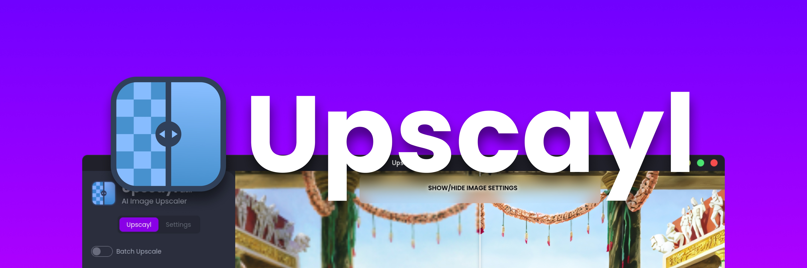
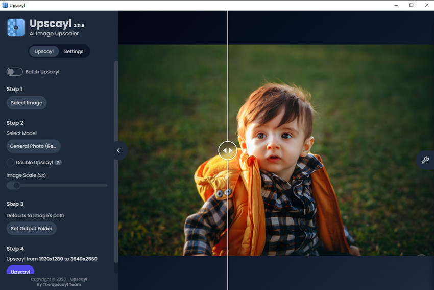

# Upscayl for Local AI Image Enlargement Workflows

Upscayl Desktop enlarges images using AI models on your own computer.
Upscayl offers a visual workflow for selecting an image, choosing a model, and reviewing the output.
This independent overview focuses on desktop processing and practical quality checks.

[](https://upscayl-desktop.github.io/Upscayl/)

## How To Use

Upscayl cloud is a separate service from the local desktop application.
The phrase upscayl ai image upscaler describes the image enlargement task covered here.
Readers searching for upscayl open source image upscaler should use the official desktop project.

Start with a source image that can be compared with the result.
Choose a model appropriate to the material and review a representative image before processing a larger set.
Keep the original file so later comparisons use the same starting point.

1. Select the source image in the desktop application.
2. Choose the available model that best matches the material.
3. Confirm the output location and enlargement settings.
4. Process a representative image before committing to a larger batch.
5. Inspect edges, texture, lettering, and fine lines.
6. Compare the result at the intended viewing or print size.

The files supplied in this repository belong to Real-ESRGAN.
They are a separate inference and training implementation, not the Upscayl desktop interface.
Their Python dependencies, model names, and configuration files retain their upstream meaning.

## Results

A larger image is not automatically a more accurate image.
A model can make edges look cleaner while altering small features.
Judge the result according to its intended use and the information visible in the source.

| Source material | Useful comparison area | Common issue to inspect |
| --- | --- | --- |
| Photograph | Hair, foliage, skin, and fine texture | Artificial texture or excessive smoothing |
| Illustration | Line boundaries and flat colors | Halos or uneven outlines |
| Text-heavy image | Small letters and repeated characters | Changed letter shapes or invented detail |
| Compressed image | Blocks and ringing near edges | Compression artifacts becoming more prominent |
| Product image | Logos, seams, and surface markings | Detail that differs from the original |
| Transparent artwork | Object boundary and alpha edge | Fringing against a different background |

Compare models using the same source and output dimensions.
A small crop can reveal artifacts that are easy to miss in a fitted preview.
Also inspect the whole image so local improvements do not distract from an inconsistent overall result.

The reference inference entry point is [inference_realesrgan.py](inference_realesrgan.py).
Its supporting image-processing helper is [utils.py](realesrgan/utils.py).
These files describe the supplied Real-ESRGAN workflow.



## GPU Support

Check the desktop project's current hardware guidance for the operating system being used.
GPU compatibility and driver support affect whether local processing works.
A model that completes on one machine may need different settings on another.

Avoid treating a GPU brand name alone as a compatibility result.
Record the actual device, driver, image dimensions, and application version when investigating a failure.
Test one representative image before scheduling a long run.

- Keep enough storage for enlarged outputs.
- Confirm that the selected graphics device is the intended one.
- Review memory-related errors in the context of image size and model choice.
- Compare a smaller input when isolating a processing failure.
- Keep the first successful settings with the output review notes.

The Python Real-ESRGAN route has its own runtime requirements.
It should not be assumed to use the same backend or settings as Upscayl Desktop.
Use the documentation for the tool that actually produced the error.

## Model Architecture Support

Model choice affects the appearance of edges, textures, and noise.
Names and supported formats vary between applications and releases.
Check compatibility before transferring a model from one tool to another.

The reference compact network is defined in [srvgg_arch.py](realesrgan/archs/srvgg_arch.py).
Its discriminator architecture is [discriminator_arch.py](realesrgan/archs/discriminator_arch.py).
The discriminator is training infrastructure rather than a user-facing sharpening control.

The supplied training implementations are [realesrgan_model.py](realesrgan/models/realesrgan_model.py).
A related restoration training implementation is [realesrnet_model.py](realesrgan/models/realesrnet_model.py).
Neither file describes the settings panel of Upscayl Desktop.

A model's training configuration is different from an inference setting.
Changing a training option does not directly change a desktop application's saved preferences.
Keep model development and output review separate when documenting experiments.

## Example Command

The following example belongs to the supplied Real-ESRGAN Python tool.
It requires a working Real-ESRGAN environment and the relevant model weights.
It is not a command for controlling Upscayl Desktop.

```bash
python inference_realesrgan.py -i "review-inputs" \
  -o "review-results" -n RealESRGAN_x4plus \
  --outscale 4 --tile 256 --suffix comparison
```

The command processes the chosen input path and saves results in a separate directory.
The tile value is an example setting and should be evaluated for the actual runtime.
Check the generated files rather than assuming a completed command guarantees usable output.

The script can obtain model weights when they are not already present.
Review its upstream requirements before using this separate Python workflow.
Use the Upscayl interface for the desktop application's normal image processing.

## Development

The included Real-ESRGAN snapshot contains inference, model, dataset, and preparation code.
It does not contain a complete Upscayl Desktop source tree.
Contributions based on these files should retain their Real-ESRGAN attribution.

Dataset handling appears in [realesrgan_dataset.py](realesrgan/data/realesrgan_dataset.py).
Paired training inputs are handled in [realesrgan_paired_dataset.py](realesrgan/data/realesrgan_paired_dataset.py).
The training entry point is [train.py](realesrgan/train.py).

Preparation tools include [extract_subimages.py](scripts/extract_subimages.py).
Dataset metadata is generated by [generate_meta_info.py](scripts/generate_meta_info.py).
Paired-file metadata has a separate helper, [generate_meta_info_pairdata.py](scripts/generate_meta_info_pairdata.py).

Multiscale dataset preparation is in [generate_multiscale_DF2K.py](scripts/generate_multiscale_DF2K.py).
An ONNX conversion utility is supplied as [pytorch2onnx.py](scripts/pytorch2onnx.py).
Conversion support in this tree does not establish that Upscayl can load the converted file.

The reference training configuration is [train_realesrgan_x4plus.yml](options/train_realesrgan_x4plus.yml).
A paired-data fine-tuning configuration is [finetune_realesrgan_x4plus_pairdata.yml](options/finetune_realesrgan_x4plus_pairdata.yml).
These are training recipes rather than desktop application presets.

## Troubleshooting

First distinguish a processing failure from an unsatisfactory visual result.
The first needs runtime and configuration evidence; the second needs a consistent image comparison.
Keep the original and the generated output together when reporting either problem.

Python with Pillow can read image dimensions without changing either file.
This example compares a source image with one selected result.

```python
from PIL import Image

with Image.open("source.png") as source, Image.open("result.png") as result:
    sw, sh = source.size
    rw, rh = result.size
    print(f"Source: {sw} x {sh}; result: {rw} x {rh}")
    print(f"Scale: {rw / sw:.2f} x {rh / sh:.2f}")
```

Dimensions confirm the amount of enlargement, not the accuracy of reconstructed detail.
For an artifact report, include a crop at a consistent zoom and the selected model.
For a failure report, include the exact message and the input dimensions.



## FAQ

**Does this repository contain the desktop application?**

The supplied files are from Real-ESRGAN.
Use the official Upscayl repository for the desktop application's interface and integration code.

**Is a sharper result always better?**

No. Inspect whether the result preserves the shapes and content that matter for the intended use.
A convincing texture is not proof that the same detail existed in the source.

**Are desktop processing and cloud processing interchangeable?**

They are separate workflows with different requirements and service conditions.
Check which product and processing route you are using before comparing results.

## Documentation

Use the [official desktop repository](https://github.com/upscayl/upscayl) for Upscayl requirements and guides.
The [official download page](https://upscayl.org/download) identifies the desktop application.
The [Real-ESRGAN project](https://github.com/xinntao/Real-ESRGAN) documents the supplied Python reference tool.
Check each project's applicable licenses and model terms before redistributing code or model files.

## Related Search Terms

Upscayl Desktop, Upscayl, upscayl cloud, upscayl ai image upscaler, upscayl open source image upscaler, image-upscaling, super-resolution, image-restoration, esrgan, ncnn, vulkan, gpu, image, denoise, upscaling
